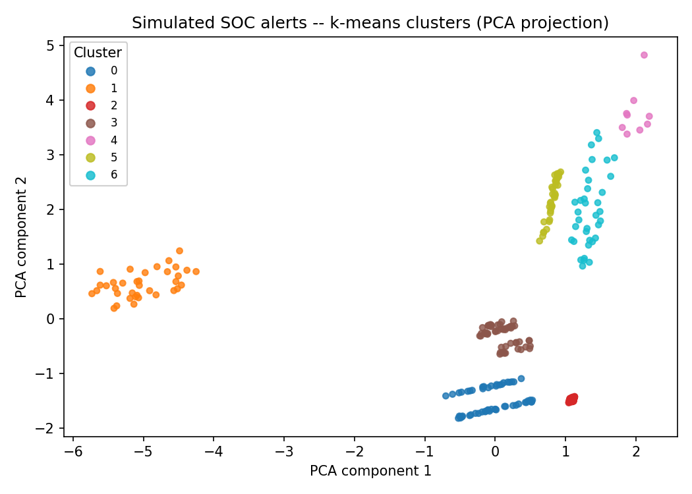

# SOC Alert Clustering — Simulated Alert Grouping with k-means

A small, hands-on project applying **pandas** and **scikit-learn** to
security-style tabular data: load simulated SOC alerts, clean and encode
them with pandas, then group similar-looking events with **k-means**.

> **This is a learning/demo project, not a detection tool.** The data is
> entirely synthetic (see [Data](#data)), and clustering is a statistical
> grouping method — it does **not** by itself prove that an incident or
> attack occurred. See [Limitations](#limitations) before drawing
> conclusions from the output.

## Overview

Security Operations Centers deal with a high volume of alerts that often
need to be triaged by similarity before an analyst looks at them one by
one. This project is a small-scale exercise in that idea: given a table of
fictional alerts (source/destination IP, port, protocol, alert type,
severity, byte volume, event count), it uses k-means to group alerts that
look similar on those fields, so that an analyst could in principle review
one representative per group instead of every row individually.

## How it works

1. **`src/generate_data.py`** builds a fictional CSV of alerts from six
   hand-defined "profiles" (e.g. `Failed Login`, `Port Scan`, `Malware
   Signature Match`, `DNS Tunneling Suspected`, `Unusual Outbound
   Traffic`, `Informational / Benign`) plus randomised noise, so the
   dataset has a few genuinely different event shapes to find — not
   perfectly separated, and not labelled as "attacks."
2. **`src/cluster_alerts.py`**:
   - loads the CSV with pandas and validates/cleans it (required columns,
     dropped rows with missing values, severity mapped to an ordinal rank);
   - builds a numeric feature matrix (`dst_port`, `bytes_transferred`,
     `event_count`, `severity_rank`, one-hot `protocol` and `alert_type`);
   - scales features with `StandardScaler` and clusters them with
     `KMeans` from scikit-learn;
   - if `--k` isn't given, picks `k` automatically over a range by
     **silhouette score** (a measure of how well-separated the clusters
     are — see [Choosing k](#choosing-k));
   - prints a per-cluster summary and saves the clustered data, the
     summary table, and a 2D PCA scatter plot to `outputs/`.

## Data

`data/sample_alerts.csv` is **entirely fictional**, generated by
`generate_data.py` with a fixed random seed (so it's reproducible). IPs
are drawn from private ranges (`10.0.0.0/8`, `192.168.0.0/16`) and do not
correspond to any real host, network, or incident.

| Column | Meaning |
|---|---|
| `alert_id` | synthetic identifier |
| `timestamp` | fictional event time |
| `src_ip`, `dst_ip` | fictional private IPs |
| `dst_port`, `protocol` | destination port and protocol |
| `alert_type` | one of 6 fictional alert categories |
| `severity` | `Low` / `Medium` / `High` |
| `bytes_transferred` | fictional byte volume for the event |
| `event_count` | fictional repetition count in a short window |

## Installation

```bash
git clone https://github.com/Ryad-Cyber/soc-alert-clustering.git
cd soc-alert-clustering
python -m venv .venv
source .venv/bin/activate   # Windows: .venv\Scripts\activate
pip install -r requirements.txt
```

Tested with **Python 3.13**, pandas 2.3, scikit-learn 1.8, matplotlib 3.10.
Earlier versions within `requirements.txt`'s bounds should work but
haven't all been tested.

## Usage

```bash
# 1. (Re)generate the fictional dataset (data/sample_alerts.csv is
#    already included in the repo, so this step is optional)
python src/generate_data.py --rows 300 --seed 42

# 2. Cluster the alerts, letting silhouette score pick k automatically
python src/cluster_alerts.py

# ...or fix the number of clusters yourself
python src/cluster_alerts.py --k 6

# ...or point it at a different input / output location
python src/cluster_alerts.py --input data/sample_alerts.csv --outdir outputs
```

Each run prints a cluster summary to the console and writes three files to
`outputs/`: `clustered_alerts.csv` (every alert with its assigned
cluster), `cluster_summary.csv` (one row per cluster), and
`cluster_plot.png` (a 2D PCA projection, coloured by cluster, purely for
visualisation — clustering itself runs on the full feature set, not on
the 2D projection).

## Example output

Running `python src/cluster_alerts.py` on the included `data/sample_alerts.csv`
(300 rows, `--seed 42`) produces 7 clusters (silhouette score picked `k=7`):

```
Silhouette score by k: {2: 0.456, 3: 0.434, 4: 0.528, 5: 0.661, 6: 0.756, 7: 0.79, 8: 0.748}
Selected k=7 (highest silhouette score)

Cluster summary:
         alert_count       dominant_alert_type dominant_protocol  mean_severity_rank  mean_bytes_transferred  mean_event_count  mean_dst_port  distinct_src_ip
cluster
2                 75    Informational / Benign               TCP                 0.0                  1560.8               2.8          254.2               43
0                 54                 Port Scan               TCP                 0.4                   239.1              44.3          502.6               31
3                 54              Failed Login               TCP                 1.6                  1203.0              22.2         1206.7               25
1                 36   DNS Tunneling Suspected               UDP                 1.4                 10519.2              63.9           53.0               21
5                 36   Malware Signature Match               TCP                 2.0                 31130.8               2.4         6978.9               25
6                 36  Unusual Outbound Traffic               TCP                 0.4                 42007.9               5.4         6002.7               21
4                  9  Unusual Outbound Traffic               TCP                 0.7                 33184.0               3.9        51820.0                9
```

Most clusters line up closely with the six fictional alert types used to
generate the data (expected, since the generator's profiles are fairly
distinct on the features used). One instructive exception: clusters 6 and
4 are **both** dominated by `Unusual Outbound Traffic`, split into two
groups — cluster 4 is the subset consistently using destination port
`51820`, which pulled those rows apart from the rest on the `dst_port`
feature even though they share the same alert type. This is a useful,
genuine example of the limitation below: k-means groups by **feature
similarity**, not by ground-truth label, so a single alert type can split
across clusters, and (in the other direction) different alert types could
in principle end up in the same cluster if their feature values overlap.



### Choosing k

`choose_k()` loops `k` from `--k-min` to `--k-max` (defaults: 2 to 8),
fits k-means for each, and scores the result with scikit-learn's
[`silhouette_score`](https://scikit-learn.org/stable/modules/generated/sklearn.metrics.silhouette_score.html)
(ranges from -1 to 1; higher means better-separated clusters). The script
picks the `k` with the highest score. This is one simple, interpretable
way to let the data suggest a cluster count — it is not the only valid
method, and the statistically "best" `k` is not guaranteed to be the most
useful grouping for a human analyst to triage (see
[Limitations](#limitations)).

## Screenshots

*(To be added.)* This section is reserved for terminal run screenshots
and/or an annotated view of the output files, to be added after this
initial publication.

## Limitations

- **Clustering is not detection.** A group of statistically similar
  alerts is not, by itself, evidence that an incident or attack took
  place — it only means those alerts look similar on the features used.
  Interpreting a cluster as suspicious requires analyst judgement and
  context this project does not have.
- **Synthetic data.** The dataset is generated from hand-picked profiles,
  not real traffic or real alerts. Results on real SOC data would depend
  entirely on which features are available and how well they separate
  genuinely different event types — that has not been tested here.
- **Feature choice drives the outcome.** k-means only "sees" the features
  it's given (`dst_port`, `bytes_transferred`, `event_count`,
  `severity_rank`, `protocol`, `alert_type`). Different or additional
  features (e.g. time-of-day, geolocation, process name) would likely
  produce different clusters entirely.
- **k-means assumptions.** k-means assumes roughly spherical,
  similarly-sized clusters in the scaled feature space and requires `k`
  to be chosen; it can perform poorly on differently shaped or
  differently sized groups, and silhouette score is only one of several
  valid ways to pick `k`.
- **No ground-truth validation.** Because the "true" alert type is known
  only because this is synthetic data, cluster quality could be checked
  informally against it here — on real alerts, there is usually no such
  ground truth to validate against.
- **Screenshots not yet included** — see the [Screenshots](#screenshots)
  section above.

## Skills demonstrated

- Data preparation and cleaning with **pandas** (validation, missing-value
  handling, categorical encoding, ordinal encoding).
- Feature scaling and unsupervised clustering with **scikit-learn**
  (`StandardScaler`, `KMeans`, `silhouette_score`, `PCA` for visualisation).
- Model-selection reasoning (choosing `k` via silhouette score, and
  recognising its limits).
- Communicating clustering results responsibly: separating "what the
  algorithm found" from "what it means," with explicit limitations.
- Basic test coverage with Python's built-in `unittest` for both the data
  generator and the clustering pipeline.

## Project structure

```text
soc-alert-clustering/
├── data/
│   └── sample_alerts.csv       # generated fictional dataset (checked in for convenience)
├── outputs/                    # created by cluster_alerts.py (summary, clustered CSV, plot)
├── src/
│   ├── generate_data.py        # builds the fictional dataset
│   └── cluster_alerts.py       # cleans, clusters, summarises, plots
├── tests/
│   └── test_project.py         # unittest coverage for both scripts
├── requirements.txt
└── README.md
```

## License

No license file is included; all rights reserved by default. Open an
issue if you'd like to reuse this for teaching or demo purposes.
